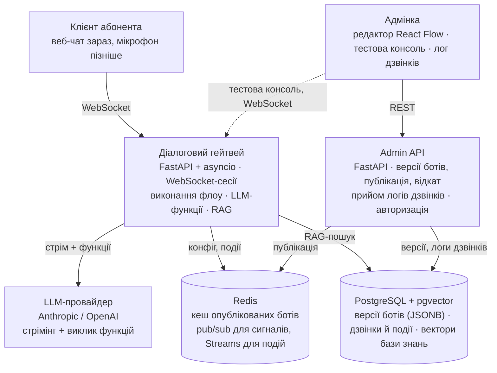

# Rozmova — продуктові вимоги (PRD)

Oct 14, 2026 · @Serhii

Rozmova — платформа голосових AI-агентів: Hvylia Mobile автоматично відповідає на типові дзвінки абонентів, а бізнес змінює поведінку бота без релізу від розробників.

## Контекст

Hvylia Mobile — вигаданий український мобільний оператор, замовник цього проєкту. Усі цифри нижче — ілюстративні припущення, а не реальні ринкові дані.

- Близько 3 млн абонентів, лінія підтримки українською.
- Більшість звернень закривають живі оператори; поточний IVR — жорстке меню «натисніть 1 / натисніть 2».
- Більшість дзвінків однотипні: баланс, поточний тариф, як змінити тариф, як підключити чи відключити послугу, правила роумінгу.
- Тарифи й послуги змінюються кілька разів на місяць; будь-яка зміна сценаріїв IVR проходить через релізний цикл IT.

## Проблема

Типові питання займають живих операторів, а бізнес не може швидко й безпечно змінювати поведінку бота.

1. **Вартість і очікування.** Оператори витрачають більшу частину зміни на питання, на які система відповіла б із даних; абонент чекає в черзі заради відповіді на 30 секунд.
2. **Жорсткий IVR.** Меню не розуміє вільне мовлення («скільки в мене грошей»), тож абонент тисне 0 і все одно потрапляє до оператора.
3. **Повільні зміни.** Новий тариф чи правка сценарію потребують розробника й релізу. Маркетинг запускає тариф раніше, ніж бот про нього дізнається.
4. **Ризик неправильних відповідей.** Звичайний чат-бот може вигадати ціну чи умову. Для оператора це скарга і юридичний ризик.
5. **Немає прозорості.** Коли дзвінок пішов не так, ніхто не може швидко побачити, що бот почув, що вирішив і який крок гальмував.

## Цілі та метрики успіху

MVP доводить три речі: бот закриває типові питання, бізнес змінює його без розробників, відповіді залишаються точними.

| Ціль | Метрика | Ціль MVP |
| --- | --- | --- |
| Закривати типові питання | Частка eval-сценаріїв, пройдених без переведення на оператора | ≥ 80% |
| Відповідати точно | Faithfulness до бази знань (DeepEval) | ≥ 0.9 |
| Викликати правильну дію | Коректність виклику функцій на eval-наборі | ≥ 95% |
| Відповідати швидко | Час до першого токена, p95 (текст) | < 1.5 с |
| Змінювати без релізу | Час від правки флоу до живого бота | < 1 хв, без деплою |
| Не піддаватися маніпуляціям | Відхилені prompt-injection кейси | 100% eval-кейсів |

Цільові значення — стартові припущення; уточнюються після першого прогону evals.

## Користувачі

| Користувач | Хто це | Що йому потрібно |
| --- | --- | --- |
| Абонент | Телефонує або пише в підтримку | Правильна відповідь українською за секунди; оператор, якщо бот не впорався |
| Автор бота | Продакт або маркетолог, не розробник | Візуально збирати й змінювати сценарії, тестувати, публікувати й відкочувати |
| Інженер підтримки | Черговий інженер платформи | Бачити кожен дзвінок покроково, знайти повільний чи зламаний крок, усунути причину |
| Розробник платформи | Будує та випускає платформу | Зрозуміла документація архітектури, тести й evals ловлять регресії, реліз однією командою |

## Ключові сценарії

**S1. Абонент перевіряє баланс.** Питає своїми словами; бот викликає функцію балансу й називає суму. Відповідь стрімиться, перші слова з'являються менш ніж за 1.5 с.

**S2. Абонент питає про тариф.** «Що входить у тариф Безлім?» Бот шукає в затвердженій базі знань і відповідає лише за нею. Якщо нічого не знайшов — так і каже й пропонує оператора.

**S3. Абонент підключає послугу.** Бот називає ціну, просить явного підтвердження і лише потім викликає підключення. Немає підтвердження — немає дії.

**S4. Автор бота змінює сценарій.** Відкриває редактор флоу, додає крок (наприклад, промо-питання перед переведенням на оператора), перевіряє у вбудованій консолі, публікує. Нові дзвінки йдуть за новою версією, поточні завершуються на старій. Невдала зміна відкочується одним кліком.

**S5. Інженер розбирає проблемний дзвінок.** Знаходить дзвінок за id і бачить таймлайн: що сказав абонент, який крок флоу спрацював, яка функція викликалась, скільки тривав кожен крок.

**S6 (голос, пізніше). Абонент говорить замість того, щоб друкувати.** Мовлення розпізнається, бот відповідає й озвучує відповідь. Абонент може перебити бота на півслові.

## Функціональні вимоги

**Діалог**

- FR-1. Діалогова сесія в реальному часі через WebSocket; відповідь стрімиться по токенах.
- FR-2. Бот викликає дії абонента: баланс, поточний тариф, список послуг, підключення послуги (з підтвердженням).
- FR-3. Відповіді про тарифи й послуги — лише із затвердженої бази знань (RAG); бот зазначає, на які документи спирався.
- FR-4. Нове повідомлення абонента скасовує відповідь, яка ще генерується.
- FR-5. Переведення на оператора, якщо бот не впорався або абонент сам просить.

**Конфігурація бота**

- FR-6. Бот — це флоу з кроків: старт, LLM-промпт, дія, відповідь із бази знань, умова, переведення на оператора, кінець.
- FR-7. У бота одна чернетка, яка редагується на місці; публікація створює незмінну пронумеровану версію й робить її живою; відкат створює нову версію з копією старої та публікує її.
- FR-8. Опубліковані зміни доходять до діалогового сервісу без деплою; поточні дзвінки залишаються на своїй версії.
- FR-9. Флоу з помилками (немає кінця, недосяжні кроки, не заповнені налаштування) не можна опублікувати.

**Адмінка**

- FR-10. Візуальний редактор флоу: перетягувати кроки, з'єднувати їх, налаштовувати кожен у боковій формі.
- FR-11. Вбудована тестова консоль: листування з чернеткою бота, активний крок підсвічується на схемі.
- FR-12. Список ботів та історія версій із диффом між ними; дифф порівнює логіку (кроки, зв'язки, налаштування), а не розташування кроків на полотні.
- FR-13. Лог дзвінків: список і таймлайн кожного дзвінка (повідомлення, кроки, дії, таймінги); поточні дзвінки видно в реальному часі.
- FR-14. Вхід для адмінів; доступ до демо за кодом доступу з роллю лише на читання; діалогова сесія відкривається лише з короткоживучим підписаним токеном.

**База знань**

- FR-15. Завантаження документів про тарифи й послуги українською; переіндексація при змінах.

**Провайдери та доступи**

- FR-16. Для кожного бота обирається LLM-провайдер (Anthropic, OpenAI, Azure OpenAI) без зміни коду.
- FR-17. Ключі провайдерів зберігаються зашифрованими, задаються в адмінці й ніколи не показуються повністю.
- FR-18. Пошук по конфігураціях: які боти й версії використовують задану дію чи крок (потрібно перед зміною дії).

**Якість та експлуатація**

- FR-19. Перед публікацією версія проганяється на еталонних діалогах; результат видно в адмінці, публікація нижче порогу блокується.
- FR-20. Сторінка «Операції» в адмінці: активні дзвінки, затримки за етапами, частка помилок.
- FR-21. Обрив зв'язку чи викладка нової версії сервісу не втрачають розмову: активні сесії дочікуються завершення, історія дзвінка зберігається.

## Нефункціональні вимоги

| Область | Вимога |
| --- | --- |
| Затримка | Перший токен p95 < 1.5 с у текстовому режимі. Вимірюється наскрізно: від отримання репліки абонента гейтвеєм до відправки першого фрагмента відповіді, включно з пошуком у базі знань і викликами дій. Таймінги кожного ходу записуються |
| Навантаження | Один інстанс гейтвея тримає 50 одночасних сесій без зростання p95; підтверджується навантажувальним тестом |
| Надійність | Збій LLM-провайдера чи дії дає абоненту зрозумілу помилку, а не зависання; таймаути й ретраї з backoff; graceful shutdown |
| Якість | Юніт- та інтеграційні тести; eval-набір українською запускається в CI і блокує реліз нижче порогу |
| Спостережуваність | Структуровані логи з call id через усі сервіси; трейс на кожен дзвінок за етапами; метрики у форматі Prometheus |
| Безпека | Ключі провайдерів зашифровані; доступ до демо за кодом; WebSocket гейтвея лише з підписаним токеном; база даних і Redis без публічного доступу; prompt-injection кейси в eval-наборі |
| Контроль витрат | Rate limit на відвідувача, ліміт тривалості сесії, ліміти витрат на LLM-ключах і хостингу |
| Постачання | Контейнери; реліз за git-тегом з автодеплоєм і відкатом (демо — Railway); той самий стек розгортається на будь-якому VPS через Docker Compose; один пайплайн у GitHub Actions і GitLab CI |
| Експлуатація | Runbook на типові інциденти; кожен розібраний інцидент завершується тестом або алертом-запобіжником |
| Документація | Огляд архітектури та ADR на кожне значуще рішення; docs у репо — основний контекст для coding-агента |
| Мова | Контент для абонента й база знань — українською. PRD і SDD — українською (їх показують замовнику). Код, тікети й решта технічної документації в репо (ADR, runbooks, protocol.md, README, CLAUDE.md) — англійською |

## Скоуп

**MVP (текстовий канал)** — сценарії S1–S5, вимоги FR-1…FR-21, задеплоєне публічне демо з дашбордом.

**Далі** — голосовий канал (S6): детекція мовлення (VAD), розпізнавання, синтез, перебивання; англійський інтерфейс.

**Не робимо**

- Реальну телефонію (SIP, АТС) — максимум технічний спайк.
- Реальні дані абонентів, білінг, CRM — дії працюють на моках.
- Мультитенантність, ролі та права понад адміна й демо-глядача.
- Бренд, тарифи й ціни реального оператора.

## Архітектура

Зміни з адмінки доходять до дзвінків через Redis, без деплою.

Ядро — діалоговий гейтвей: тримає кожну розмову, виконує опублікований флоу й викликає LLM. Admin API відповідає за конфігурацію та логи; під час публікації версії він повідомляє гейтвей через Redis, тому деплой не потрібен.

## План

Публічне демо — після 2-го дня; MVP — на 6-й день.

| Етап | Коли | Зміст |
| --- | --- | --- |
| Гейтвей діалогу | День 1 | Репо, CLAUDE.md, ADR; WebSocket-сесії; стрімінг LLM; виклик функцій |
| Дані та деплой | День 2 | База знань і RAG; чернетка й версії; публікація через Redis; Railway + CI/CD за тегом |
| **Гейт 1: демо в проді** | кінець дня 2 | Текстовий бот, функції, RAG, HTTPS |
| Редактор флоу | Дні 3–4 | Полотно React Flow; виконання флоу; форми кроків; тестова консоль |
| Якість і реліз | Дні 5–6 | pytest + DeepEval; evals-гейт у CI; метрики й трейси; GitLab CI + README |
| **Гейт 2: MVP готовий** | кінець дня 6 | S1–S5 пройдено, evals зелені |

Після MVP: голосовий канал (VAD, розпізнавання, синтез, перебивання).

Публічне демо з'являється вже після другого етапу, тож усі наступні зміни одразу проходять через CI/CD і перевіряються на живому середовищі.

## Ризики, припущення, рішення

| Ризик | Наслідок | Що робимо |
| --- | --- | --- |
| Скоуп MVP більший за доступний час | Демо не готове вчасно | Жорстка межа MVP; голос — лише після деплою MVP |
| LLM вигадує деталі тарифів | Абонент отримує неправильну інформацію | Відповіді лише з бази знань; faithfulness-eval блокує реліз |
| Публічне демо спалює бюджет API | Неочікувані витрати | Доступ за кодом, підписаний токен сесії, rate limit, ліміти витрат на ключах і хостингу |
| Якість моделей та ембедингів українською | Слабкий пошук чи формулювання | Порівняти моделі на eval-наборі, зафіксувати в ADR |

**Припущення:** мокових дій достатньо, щоб показати function calling; для демо вистачить одного проєкту на Railway.

**Прийняті рішення** (обґрунтування — у SDD)

- LLM: кандидати — GPT-4.1 mini і новіші mini-моделі OpenAI, Claude Haiku 5.5; остаточний вибір основної та резервної — за результатами eval-набору (TTFT, коректність викликів дій, якість української).
- Ембединги: text-embedding-3-small із контрольним порівнянням з text-embedding-3-large.
- Хостинг демо: Railway; прод-варіант — Docker Compose на VPS.
- Голос після MVP: хмарне розпізнавання (Deepgram).
