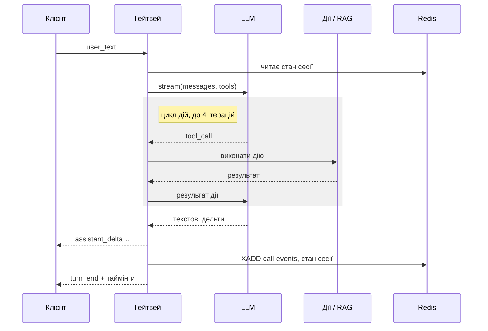

# Rozmova — технічний дизайн (SDD)

Oct 14, 2026 · @Serhii

Документ описує, як Rozmova реалізує вимоги з PRD: два Python-сервіси на FastAPI/asyncio, спільний пакет-движок діалогу, PostgreSQL + Redis як спільне сховище, React-адмінка. Кожна значуща альтернатива фіксується окремим ADR у `docs/adr/`.

## Огляд

Ключові рішення:

- **Гейтвей і Admin API — окремі сервіси.** Гейтвей тримає довгі WebSocket-сесії й масштабується за кількістю дзвінків; Admin API — звичайний CRUD. Різний профіль навантаження й релізів.
- **Движок діалогу — спільний пакет `packages/engine`.** Виконавець флоу, LLM-провайдери, дії та RAG не належать гейтвею: їх однаково використовують гейтвей (живі дзвінки), Admin API (evals перед публікацією) і CI (eval-набір). Гейтвей — тонкий шар WebSocket навколо движка.
- **Сесія = набір asyncio-задач під одним `TaskGroup`.** Скасування ходу, таймаути й graceful shutdown будуються на стандартних примітивах asyncio, без зовнішніх черг.
- **Одна чернетка, незмінні версії.** Чернетка бота редагується на місці; публікація створює незмінну версію й переставляє вказівник «live». Гейтвей бере версію на старті дзвінка й не міняє її до кінця.
- **Pub/sub — для сигналів, Redis Streams — для подій дзвінків.** Pub/sub втрачає повідомлення без підписника, тому лог дзвінків іде через стрім із consumer group.
- **Контракти — в одному місці.** Pydantic-моделі протоколу й флоу є джерелом правди; JSON Schema і TS-типи для адмінки генеруються з них.
- **Демо — на Railway, прод-варіант — Docker Compose на VPS.** Ті самі образи; Railway обрано заради швидкого старту без адміністрування сервера.
- **Гейтвей недоступний без підписаного токена.** Сесію відкриває лише клієнт, що отримав короткоживучий тікет від Admin API, тож LLM-ключ не можна використати напряму.

## Стек і структура репозиторію

| Шар | Технології |
| --- | --- |
| Backend | Python 3.12, FastAPI, Pydantic v2, asyncio, uvicorn, uv (workspace) |
| Дані | PostgreSQL 16 + pgvector, SQLAlchemy 2.0 (async, asyncpg), Alembic |
| Кеш і події | Redis 7, redis-py (asyncio): cache, pub/sub, Streams |
| LLM | OpenAI SDK, Anthropic SDK; кандидати моделей — у розділі «LLM-шар»; ембединги text-embedding-3-small |
| Frontend | React, TypeScript, Vite, React Flow (xyflow), Zustand, TanStack Query, React Hook Form + zod, Tailwind, Radix UI |
| Якість | pytest, pytest-asyncio, testcontainers, DeepEval, ruff, mypy, eslint |
| Спостережуваність | structlog, OpenTelemetry SDK, prometheus-client; локально Jaeger, Prometheus, Grafana |
| Інфра | Docker, Docker Compose (локально й VPS), Railway (демо), Caddy (VPS), GitHub Actions, GitLab CI, GHCR |

```
rozmova/
├── apps/
│   ├── gateway/        # FastAPI: WebSocket-сесії, тікети, rate limit; викликає engine
│   ├── admin-api/      # FastAPI: боти, чернетка, версії, логи, auth, запуск evals
│   └── admin-web/      # React + Vite, збирається й віддається admin-api
├── packages/
│   ├── contracts/      # Pydantic-моделі протоколу і флоу → JSON Schema → TS
│   ├── engine/         # виконавець флоу, LLM-провайдери, дії, RAG, eval-раннер
│   └── core/           # спільне: db, redis, logging, telemetry, settings
├── evals/              # eval-набір (YAML) + DeepEval-тести
├── kb/                 # документи бази знань (Markdown, українською)
├── infra/              # compose.dev.yml, compose.prod.yml, Caddyfile, Grafana, конфіг Railway
├── docs/               # architecture.md, adr/, runbooks/, protocol.md (англійською); PRD і SDD українською
├── CLAUDE.md
├── .github/workflows/
└── .gitlab-ci.yml
```

## Діалоговий гейтвей

Кожне WebSocket-з'єднання — це об'єкт `Session` з трьома задачами під одним `asyncio.TaskGroup`; збій будь-якої з них коректно закриває всю сесію.

| Задача | Відповідальність |
| --- | --- |
| `reader` | Читає повідомлення клієнта, валідує через Pydantic, кладе в `inbox` (`asyncio.Queue`) |
| `turn_loop` | Бере повідомлення з `inbox`, запускає хід як окрему задачу `current_turn`, керує скасуванням |
| `writer` | Відправляє події з обмеженої `outbox` (`maxsize=256`), шле ping кожні 15 с |

**Скасування ходу (FR-4).** Нове `user_text` під час генерації → `current_turn.cancel()` → `await` задачі з поглинанням `CancelledError` → клієнт отримує `turn_cancelled`. Код ходу не ловить `CancelledError` без повторного підняття, а ресурси (стрім LLM, HTTP-клієнти) закриваються в `async with`. Часткова відповідь зберігається в історії з позначкою `interrupted`, щоб LLM бачила, що абонент її перебив.

**Дії з побічним ефектом не скасовуються посередині.** Виконання `activate_service` загортається в `asyncio.shield()`: якщо репліка прийшла під час виклику, дія довиконується, результат записується в історію, і лише потім хід скасовується. Інакше послуга була б підключена, а бот про це не знав би.

**Помилки ходу не губляться.** `current_turn` створюється поза `TaskGroup`, тому виняток у ньому не піднімається автоматично. `run_turn` сам ловить усе, крім `CancelledError`, і перетворює на подію `error` для клієнта й запис у лог; `turn_loop` додатково перевіряє `task.exception()` після завершення.

**Таймаути.** Весь хід — `asyncio.timeout(30)`, перший токен LLM — 10 с, кожна дія — 5 с. Перевищення перетворюється на типізовану подію `error` для клієнта й запис у лог, а не на обрив з'єднання.

**Backpressure.** Якщо клієнт не встигає читати й `outbox` заповнена, дрібні `assistant_delta` склеюються в одну подію; якщо черга заповнена понад 10 с — сесія закривається з кодом 1013.

**Стан сесії.** Історія повідомлень, поточний вузол флоу, слоти та `pending_action` зберігаються в Redis (`session:{call_id}`, TTL 30 хв від останнього ходу) після кожного ходу. Це дає FR-21: клієнт може перепідключитися з тим самим `call_id` і новим тікетом, поки живе цей ключ. Хід, що виконувався в момент обриву, скасовується (його часткова відповідь лишається в історії як `interrupted`); при відновленні сервер шле `session_started{resumed: true, history: […]}`, і клієнт відмальовує розмову заново. Стан пишеться до `turn_end` ходу і ще раз перед закриттям сокета, тож швидке перепідключення бачить останній хід. Завершений дзвінок (`hangup`, кінець флоу, `handoff`) ключ видаляє. Писати стан може лише з'єднання-власник (поле `owner` у хеші, перевірка й запис — Lua-скрипт): нове з'єднання з тим самим `call_id` забирає власність, і запізнілий запис старого, ще не поміченого мертвим сокета (до 30 с за ping-таймаутом) відхиляється; така сесія закривається з кодом 4409.

**Graceful shutdown (FR-21).** Railway після активації нового деплою шле старому SIGTERM і чекає `RAILWAY_DEPLOYMENT_DRAINING_SECONDS` до SIGKILL; за даними спільноти Railway дефолт — 0 с, тому змінну задаємо явно (60) разом із `RAILWAY_DEPLOYMENT_OVERLAP_SECONDS`. Перемикання трафіку не залежить від readiness-проби, тож на неї не покладаємось. На SIGTERM гейтвей: перестає приймати нові WebSocket (`503` на `/ws`), не починає нових ходів, дає активним ходам до 50 с на завершення (решта з 60 с — на відправку й закриття), шле `session_end{reason: "shutdown"}`, закриває з кодом 1012 з можливістю перепідключення (стан уже в Redis) і виходить з кодом 0 — ненульовий код Railway показує як «Deploy Crashed». Стандартна обробка SIGTERM в uvicorn для цього не годиться: вона одразу рве всі WebSocket з кодом 1012 посеред відповіді, а після зупинки повторно піднімає сигнал, і процес завершується через SIGTERM (код 143). Тому перший сигнал перехоплює власний `GatewayServer` і зупиняє uvicorn лише після drain; другий сигнал зупиняє одразу.

```python
async def run(self) -> None:
    async with asyncio.TaskGroup() as tg:
        tg.create_task(self.reader())
        tg.create_task(self.turn_loop())
        tg.create_task(self.writer())

async def turn_loop(self) -> None:
    while True:
        msg = await self.inbox.get()
        if self.current_turn and not self.current_turn.done():
            self.current_turn.cancel()
            with suppress(asyncio.CancelledError):
                await self.current_turn
            await self.emit(TurnCancelled())
        self.current_turn = asyncio.create_task(self.run_turn(msg))

async def run_turn(self, msg: UserText) -> None:
    try:
        async with asyncio.timeout(30):
            await self.engine.turn(self.state, msg.text, emit=self.emit)
    except asyncio.CancelledError:
        raise
    except Exception as exc:  # LLM, дія, RAG, таймаут
        log.exception("turn_failed", call_id=self.call_id)
        await self.emit(Error.from_exception(exc))
```

## Протокол WebSocket

Ендпоінт `WS /ws/calls/{bot_id}?call_id=…&ticket=…`; повідомлення — JSON з полем `type`, яке Pydantic розбирає як discriminated union. Невідомий чи некоректний тип дає подію `error`, а не обрив з'єднання.

| Напрям | `type` | Поля | Призначення |
| --- | --- | --- | --- |
| клієнт → сервер | `user_text` | `text` | Репліка абонента |
| клієнт → сервер | `audio_chunk` | `pcm16` (base64), `seq` | Аудіо, після MVP |
| клієнт → сервер | `hangup` | — | Завершити дзвінок |
| сервер → клієнт | `session_started` | `call_id`, `bot_version`, `resumed`, `history?` | Сесію створено чи відновлено |
| сервер → клієнт | `assistant_delta` | `turn_id`, `text` | Фрагмент відповіді |
| сервер → клієнт | `tool_call` / `tool_result` | `turn_id`, `name`, `args` / `result` | Виклик дії та її результат (лише в debug-режимі) |
| сервер → клієнт | `node_enter` | `node_id` | Флоу перейшов у вузол (лише в debug-режимі) |
| сервер → клієнт | `turn_end` | `turn_id`, `timings`, `sources` | Хід завершено: таймінги за етапами, використані фрагменти бази знань |
| сервер → клієнт | `turn_cancelled` | `turn_id` | Хід перервано новою реплікою |
| сервер → клієнт | `handoff` | `reason` | Переведення на оператора |
| сервер → клієнт | `error` | `code`, `message`, `retryable` | Типізована помилка |
| сервер → клієнт | `session_end` | `reason` | Сесію закрито (`hangup`, `timeout`, `shutdown`, `limit`) |

**Debug-режим.** `node_enter`, `tool_call` і `tool_result` розкривають внутрішню будову бота, тому відправляються лише коли тікет має прапорець `debug` — його Admin API ставить для тестової консолі (`?draft=true`) і для адмінів. Публічний демо-віджет отримує тільки текст, `turn_end` і `handoff`.

Повний опис і приклади — у `docs/protocol.md`; JSON Schema експортується в `packages/contracts` і використовується тестами та адмінкою.

## Послідовність одного ходу

Хід: стан із Redis, LLM із діями, події у Stream.



Дельти тексту йдуть клієнту одразу, по мірі надходження; події дзвінка пишуться в Redis Stream асинхронно і не затримують відповідь.

## Бюджет затримки

**Що міряємо.** Час до першого токена (TTFT) у PRD — наскрізний: від моменту, коли гейтвей прийняв `user_text`, до відправки першого `assistant_delta`. Він включає читання стану, пошук у базі знань, виклики дій і LLM. Метрика `rozmova_turn_ttft_seconds`; окремо `rozmova_llm_ttft_seconds` показує частку самого провайдера.

| Етап | Оцінка |
| --- | --- |
| Прийом, валідація, стан сесії з Redis | 10–20 мс |
| Ембединг запиту (text-embedding-3-small) | 100–200 мс |
| Гібридний пошук у PostgreSQL | 10–30 мс |
| LLM до першого токена (mini-модель без reasoning, короткий промпт) | 400–800 мс |
| Хід із дією: повний перший виклик (повертає `tool_call`) + другий виклик до першого токена | +500–900 мс |

Висновки для дизайну:

- Хід, де відповідь іде з першого виклику LLM (вітання, уточнення, `kb_answer` з уже знайденими фрагментами), вкладається в бюджет із запасом: ≈ 0.6–1.0 с.
- Хід із дією (S1, S3) або з маршрутом `route()` → `kb_answer` (S2) коштує два виклики LLM: ≈ 1.0–1.7 с. Саме ці ходи визначають p95.
- Тому правило виконавця: один хід робить не більше одного «порожнього» виклику LLM (маршрут або дія) перед тим, як почати відповідь. Два послідовні маршрути або маршрут + дія в одному ході — ознака поганого флоу; валідація попереджає.
- Важелі, якщо вимір на eval-наборі покаже p95 > 1.5 с (вмикаємо лише за потреби, у такому порядку): швидша модель за результатами evals; фраза-заповнювач на час дії (`data.filler` у вузлі, наприклад «Хвилинку, перевіряю…», стрімиться до першого виклику); попередній RAG-пошук у `llm_prompt` (`data.kb_context: true`), щоб питання про тариф закривалося першим викликом без маршруту.

Таймінги кожного ходу (`timings` у `turn_end` і в `call_events`) показують, який етап з'їв бюджет.

## LLM-шар

Увесь код поза `providers/` працює з одним інтерфейсом, тож провайдер обирається в конфігурації бота (FR-16) без змін коду.

```python
class LLMProvider(Protocol):
    def stream(
        self, messages: list[Message], tools: list[ToolSpec], *, model: str
    ) -> AsyncGenerator[TextDelta | ToolCall | Usage]: ...
```

**Моделі.** Критерії: швидкий перший токен (без reasoning), надійний function calling, прийнятна українська, низька ціна. Кандидати станом на 14.10.2026 (ціни за 1M токенів, вхід / вихід, з офіційних сторінок цін):

| Модель | Вхід | Вихід | Примітка |
| --- | --- | --- | --- |
| gpt-4.1-mini | $0.40 | $1.60 | Перевірений function calling без reasoning; стартова основна |
| gpt-5.4-mini | $0.75 | $4.50 | Новіша; перевірити TTFT (reasoning може додати затримку) |
| gpt-6-luna | $0.10 | $0.50 | Найдешевша в лінійці OpenAI; перевірити function calling і українську |
| claude-haiku-5-5 | $0.10 | $0.50 | Поточний Haiku, 1M контексту; замінює Haiku 4.5 ($1 / $5) |

Остаточний вибір основної та резервної — за прогоном eval-набору: TTFT, коректність викликів дій, якість української; результат фіксується в ADR 0009 з цифрами. Список кандидатів перевіряється ще раз перед прогоном, бо лінійки оновлюються щомісяця.

- **Реалізації:** `OpenAICompatibleProvider` (OpenAI, Azure OpenAI, OpenRouter), `AnthropicProvider`. Кожна перетворює власний формат стріму на спільні події. Для Azure OpenAI відрізняються endpoint, `api-version` і назва deployment замість моделі — це поля конфігурації провайдера, не окремий код.
- **Ретраї:** на 429/5xx до старту стріму — експоненційний backoff, 3 спроби; після першого токена ретраю немає, натомість подія `error{retryable:true}`.
- **Цикл function calling:** LLM → `ToolCall` → виконання дії → результат назад у LLM; максимум 4 ітерації на хід, далі — переведення на оператора.
- **Дії** описані Pydantic-моделями аргументів; з них генерується JSON Schema для LLM, а аргументи від LLM валідуються тією ж моделлю. Невалідні аргументи повертаються LLM як структурована помилка.
- **Дії MVP (моки):** `get_balance`, `get_current_tariff`, `list_services`, `activate_service`, `search_knowledge_base`. Остання — та сама RAG-функція, що й у вузлі `kb_answer`, доступна як дія в `llm_prompt`.
- **Ключі** провайдерів беруться з `provider_credentials` (розшифровуються в пам'яті на старті сесії), а не з env, щоб кожен бот міг мати власний ключ (FR-17).
- **Тести** використовують `FakeProvider` зі скриптованим стрімом; реальні моделі — лише в evals і на демо.

**Підтвердження дії (S3).** `activate_service` — двофазна дія, і фази розділяє код движка, а не промпт:

1. Перший виклик `activate_service(service_id)` у ході N: дія не виконується. Движок повертає LLM `{"status": "confirmation_required", "service": …, "price": …}` і записує в стан сесії `pending_action = {name, args, turn: N}`. LLM озвучує ціну й ставить питання.
2. Виклик у ході M > N із тими самими аргументами, поки `pending_action` існує: дія виконується, `pending_action` очищається.
3. Хід, що завершився без виконання дії, очищає `pending_action`. Виклик з іншими аргументами починає цикл заново.

Гарантії коду: послугу не можна підключити в тому ж ході, де названо ціну; не можна підключити іншу послугу, ніж озвучено; «так» із попередньої розмови не спрацьовує пізніше. Чи є репліка абонента згодою — вирішує LLM; eval-кейси «ні», «передумав», «змінив тему», «підключи все одразу» перевіряють, що дія не виконується.

## Флоу

Флоу — орієнтований граф у JSON, однаковий для редактора й гейтвея; схема задається Pydantic-моделлю `FlowGraph` у `packages/contracts`. Позиції вузлів на полотні живуть у `nodes[].ui` і не беруть участі ні у валідації, ні в диффі версій.

**Семантика виконання** — рівно стільки, скільки потрібно для S1–S5:

- Стан сесії: `current_node`, `slots`, `pending_action`, історія.
- Вузли двох видів. *Очікувальні* (`llm_prompt`, `kb_answer`) споживають репліку абонента й формують відповідь. *Прохідні* (`start`, `tool`, `condition`, `handoff`, `end`) виконуються одразу, без репліки.
- Старт дзвінка: виконати `start` (привітання) і прохідні вузли за ним; зупинитися на першому очікувальному — він стає `current_node`.
- Хід: репліка → виконання від `current_node`. Прохідні вузли проходяться, очікувальний споживає репліку й відповідає. Якщо `llm_prompt` замість відповіді викликав службову дію `route(name)`, виконавець іде ребром `when.route == name` і продовжує той самий хід із тією самою реплікою (так «що входить у тариф?» після маршруту `tariff` потрапляє в `kb_answer`, і абонент не повторює питання).
- Хід завершується після першого вузла, який дав відповідь абоненту. `current_node` := ціль його ребра без умови; якщо такого ребра немає, вузол залишається поточним. Наступна репліка починається звідти.
- `handoff` і `end` завершують дзвінок. Запобіжник: не більше 20 переходів за хід; перевищення — `error` і `handoff`.

| Тип вузла | Налаштування | Поведінка |
| --- | --- | --- |
| `start` | `greeting` | Точка входу, вітання; одне вихідне ребро |
| `llm_prompt` | `prompt`, `tools[]`, `routes[]` | Виклик LLM із системним промптом бота, промптом вузла, історією, дозволеними діями та службовою дією `route(name)` для кожного маршруту. Ребра: `when.route` на кожен маршрут, опційно ребро без умови |
| `tool` | `tool`, `args` (шаблон над слотами), `save_as` | Детермінований виклик дії без LLM; результат у слот; одне ребро |
| `kb_answer` | `top_k`, `min_similarity`, `not_found_reply` | Запит — остання репліка; відповідь лише з фрагментів із посиланнями; без фрагментів вище порогу — `not_found_reply`; одне ребро |
| `condition` | `cases[]: {when: JSONLogic над slots, route}` | Розгалуження без LLM; ребра `when.route`, плюс ребро без умови як default |
| `handoff` | `reason` | Переведення на оператора, завершує дзвінок |
| `end` | `farewell` | Завершення дзвінка |

**Демо-флоу Hvylia Mobile** покриває S1–S3, переведення на оператора (FR-5) і промо-крок із S4. `tool` і `condition` у ньому не потрібні; їх покривають юніт-тести виконавця.

```json
{
  "nodes": [
    {"id": "start", "type": "start",
     "data": {"greeting": "Вітаю! Я асистент Hvylia Mobile. Чим можу допомогти?"}},
    {"id": "assist", "type": "llm_prompt",
     "data": {
       "prompt": "Ти асистент оператора Hvylia Mobile. Відповідай українською, коротко. Для балансу, тарифу й послуг абонента використовуй дії. Умови тарифів і послуг не вигадуй: якщо питання про те, що входить у тариф чи послугу або скільки це коштує, виклич route('tariff'). Якщо абонент просить оператора або ти не можеш допомогти — route('operator'). Якщо абонент прощається — route('bye').",
       "tools": ["get_balance", "get_current_tariff", "list_services", "activate_service"],
       "routes": ["tariff", "operator", "bye"]}},
    {"id": "tariff_kb", "type": "kb_answer",
     "data": {"top_k": 5, "min_similarity": 0.35,
              "not_found_reply": "У базі знань немає відповіді на це питання. Хочете, переведу на оператора?"}},
    {"id": "promo", "type": "llm_prompt",
     "data": {
       "prompt": "Перед переведенням на оператора одним реченням запропонуй підписку на новини про тарифи й спитай, чи цікаво. Коли абонент відповів будь-що — виклич route('done').",
       "routes": ["done"]}},
    {"id": "operator", "type": "handoff", "data": {"reason": "requested_or_unresolved"}},
    {"id": "bye", "type": "end", "data": {"farewell": "Дякую за дзвінок. Гарного дня!"}}
  ],
  "edges": [
    {"source": "start", "target": "assist"},
    {"source": "assist", "target": "tariff_kb", "when": {"route": "tariff"}},
    {"source": "assist", "target": "promo", "when": {"route": "operator"}},
    {"source": "assist", "target": "bye", "when": {"route": "bye"}},
    {"source": "tariff_kb", "target": "assist"},
    {"source": "promo", "target": "operator", "when": {"route": "done"}}
  ]
}
```

**Прогін на папері.** Кожен рядок — один хід; `assist` без ребра без умови залишається поточним вузлом, поки LLM не викличе `route`.

| Сценарій | Репліка | Що відбувається | Події клієнту | `current_node` після |
| --- | --- | --- | --- | --- |
| старт | — | `start` → привітання → зупинка на `assist` | `session_started`, `assistant_delta` | `assist` |
| S1 | «скільки в мене грошей» | `assist`: LLM → `get_balance` → результат → «На рахунку 120,50 грн» | `tool_call`*, `tool_result`*, `assistant_delta…`, `turn_end` | `assist` |
| S2 | «що входить у тариф Безлім?» | `assist`: LLM → `route('tariff')` → `tariff_kb` з тією ж реплікою: пошук → 3 фрагменти ≥ 0.35 → відповідь з [1][2] | `node_enter(tariff_kb)`*, `assistant_delta…`, `turn_end{sources}` | `assist` (ребро без умови) |
| S2, нема в базі | «що входить у тариф Космос?» | `route('tariff')` → `tariff_kb`: найкращий фрагмент < 0.35 → `not_found_reply` | `assistant_delta…`, `turn_end{sources: []}` | `assist` |
| S3, крок 1 | «підключіть роумінг Європа» | `assist`: LLM → `activate_service('roaming_eu')` → движок: `confirmation_required`, `pending_action` записано → «Роумінг Європа — 99 грн/міс. Підключити?» | `tool_call`*, `tool_result`*, `assistant_delta…` | `assist` |
| S3, крок 2 | «так» | LLM → `activate_service('roaming_eu')` → `pending_action` з ходу N−1 збігається → виконано → «Готово, послугу підключено» | `tool_call`*, `tool_result`*, `assistant_delta…` | `assist` |
| S3, відмова | «ні, не треба» | LLM відповідає без виклику → хід завершився без дії → `pending_action` очищено | `assistant_delta…` | `assist` |
| S4/FR-5 | «дайте оператора» | `assist`: `route('operator')` → `promo` з тією ж реплікою: «Перед переведенням: хочете новини про тарифи?» | `node_enter(promo)`*, `assistant_delta…` | `promo` (ребра без умови немає) |
| S4/FR-5, далі | «ні» | `promo`: `route('done')` → `operator`: handoff | `handoff`, `session_end` | — |
| кінець | «дякую, до побачення» | `assist`: `route('bye')` → `end`: прощання | `assistant_delta…`, `session_end` | — |

\* лише в debug-режимі (тестова консоль).

Промо-крок із S4 — це саме та правка, яку автор бота робить у редакторі: додає вузол `promo`, перевішує ребро `operator` з `assist` на `promo`, перевіряє в консолі, публікує.

**Виконавець** — state machine над цим станом; на кожному вході у вузол — подія `node_enter`. **Валідація (FR-9)** перед публікацією: рівно один `start`; з `start` досяжний `handoff` або `end`; усі вузли досяжні; у кожного `llm_prompt` і `condition` на кожен маршрут є ребро; обов'язкові поля заповнені; дії існують у реєстрі. Попередження (не блокують): два маршрути поспіль без відповіді між ними (бюджет затримки). Помилки повертаються з `node_id`, щоб адмінка підсвітила вузол.

## База знань і RAG

1. **Інжест** (`make ingest` або кнопка в адмінці): Markdown-документи розбиваються за заголовками на фрагменти 300–800 токенів з перекриттям 15%; токени рахує tiktoken (`cl100k_base`, як у моделі ембедингів). Українська в цьому токенізаторі коштує приблизно вдвічі-втричі більше токенів на слово, ніж англійська, тож 800 токенів — це ~250–350 слів. Кожен фрагмент зберігає документ, розділ і хеш вмісту; незмінені фрагменти (той самий хеш) не переобчислюються.
2. **Ембединги** — `text-embedding-3-small` ($0.02 за 1M токенів), записуються в `kb_chunks.embedding` (pgvector) з індексом HNSW за cosine distance. Контрольне порівняння з `text-embedding-3-large` ($0.13) за recall@5 на eval-наборі; переходимо, лише якщо різниця суттєва (ADR 0004).
3. **Повнотекстова гілка.** У PostgreSQL немає вбудованої конфігурації для української (`ukrainian` відсутня серед `pg_ts_config`). Для MVP використовуємо конфігурацію `simple`: вона переводить текст у нижній регістр і ріже на токени без стемінгу й стоп-слів, тому працює для будь-якої мови, але «тарифу» й «тариф» для неї різні слова. Це прийнятно, бо семантику несе векторна гілка, а повнотекстова ловить точні назви тарифів і послуг («Безлім», «Роумінг Європа»); для запиту додатково вмикаємо префіксний збіг (`тариф:*`). Якщо recall@5 на eval-наборі покаже слабкість — підключити словник hunspell `uk_UA` через `CREATE TEXT SEARCH DICTIONARY … TEMPLATE ispell` (окремий ADR; файли словника треба покласти в `tsearch_data` образу).
4. **Пошук** — гібридний: top-20 за вектором + top-20 за повнотекстовим пошуком, об'єднання через Reciprocal Rank Fusion, у LLM ідуть top-5. **Поріг «нічого не знайдено»** — косинусна схожість найкращого фрагмента з векторної гілки (`min_similarity`, стартово 0.35): бал RRF залежить лише від позицій у списках і не є мірою схожості, тому для порогу не придатний.
5. **Відповідь і посилання.** Фрагменти передаються LLM пронумерованими `[1]…[5]`; LLM відповідає лише з них і ставить у тексті маркери `[n]` після тверджень. Гейтвей стрімить текст як є, а в `turn_end.sources` віддає відповідність маркерів `chunk_id` і документам. Така схема не ламає стрімінг і не потребує структурованого виводу; для голосового каналу маркери вирізаються перед синтезом. Без жодного фрагмента вище порогу бот каже, що не знає, і пропонує оператора.

## Модель даних PostgreSQL

| Таблиця | Ключові поля | Примітка |
| --- | --- | --- |
| `bots` | `id`, `name`, `provider`, `model`, `live_version_id`, `draft_flow` JSONB, `draft_updated_at`, `draft_eval_report` JSONB | Одна чернетка на бота, редагується на місці; вказівник на живу версію |
| `bot_versions` | `id`, `bot_id`, `version` (зростаючий номер), `flow` JSONB, `note`, `eval_report` JSONB, `created_at`, `created_by` | Незмінна; створюється лише публікацією. Відкат = нова версія з копією `flow` старої та `note: "rollback of v3"` |
| `provider_credentials` | `id`, `bot_id`, `provider`, `secret_ciphertext`, `last4` | Шифрування Fernet, ключ з env |
| `users` | `id`, `email`, `password_hash`, `role` | `admin` або `viewer` |
| `access_codes` | `id`, `label`, `code_hash`, `created_at`, `revoked_at`, `last_used_at` | Адресні коди доступу до демо; відкликання — `revoked_at` |
| `calls` | `id`, `bot_id`, `bot_version_id`, `user_id`, `access_code_id`, `started_at`, `ended_at`, `outcome` | Один рядок на дзвінок; видно, хто дзвонив |
| `call_events` | `id` (= id запису в Redis Stream, unique), `call_id`, `ts`, `type`, `payload` JSONB | Таймлайн дзвінка (FR-13); unique по `id` робить запис ідемпотентним |
| `kb_documents` | `id`, `title`, `source_path`, `content_hash`, `updated_at` | Документ бази знань |
| `kb_chunks` | `id`, `document_id`, `section`, `text`, `embedding` vector, `tsv` tsvector | HNSW + GIN індекси |

**Дифф версій (FR-12)** — порівняння `flow` двох версій за вузлами й ребрами без `ui`: додані, видалені, змінені вузли з переліком змінених полів. Рахується на сервері, віддається адмінці як список.

**JSONB-запити (FR-18).** GIN-індекс `jsonb_path_ops` на `bot_versions.flow` (і на `bots.draft_flow`) дозволяє швидко знайти версії, що використовують дію:

```sql
SELECT b.name, v.version
FROM bot_versions v JOIN bots b ON b.id = v.bot_id
WHERE v.flow @> '{"nodes": [{"data": {"tools": ["activate_service"]}}]}';
```

Міграції — Alembic; кожна міграція має `downgrade` і перевіряється в CI на чистій базі.

## Redis

| Ключ / канал | Тип | Пише | Читає | Призначення |
| --- | --- | --- | --- | --- |
| `bot:{id}:live` | string (JSON), без TTL | Admin API | Гейтвей | Кеш опублікованої версії; fallback — PostgreSQL |
| `bot:published` | pub/sub | Admin API | Гейтвей | Сигнал «версія змінилась» → інвалідація локального кешу |
| `session:{call_id}` | hash, TTL 30 хв | Гейтвей | Гейтвей | Стан сесії для перепідключення (FR-21) |
| `ticket:{id}` | string, TTL 60 с | Admin API | Гейтвей | Одноразовість тікета: гейтвей видаляє ключ при прийнятті |
| `call-events` | Stream, `MAXLEN ~ 100k` | Гейтвей | Admin API (consumer group `persist`) | Надійний запис подій у `call_events` |
| `calls:live` | pub/sub | Admin API | Адмінка через WS | Живий лог дзвінків (FR-13) |
| `ratelimit:{user_id}:{window}` | counter, TTL | Гейтвей | Гейтвей | Rate limit демо за користувачем із тікета |
| `eval-job:{id}` | hash, TTL 1 год | Admin API | Admin API | Статус і прогрес прогону evals (FR-19) |
| `admin-session:{sha256(id)}` | string (JSON), ковзний TTL 12 год | Admin API | Admin API | Сесія адмінки: користувач, роль, CSRF-токен; у cookie лише випадковий id; logout видаляє ключ (ADR 0014) |
| `access-code-sessions:{code_id}` | set, TTL як у сесій | Admin API | Admin API | Ключі сесій, відкритих за кодом доступу; відкликання коду видаляє їх одразу |

**Чому Stream, а не лише pub/sub.** Pub/sub не зберігає повідомлення: якщо Admin API перезапускається, події дзвінків губляться. Stream з consumer group дає at-least-once доставку й підтвердження `XACK`; запис у `call_events` ідемпотентний за id запису стріму. Повідомлення, що зависли в pending після падіння споживача, забираються через `XAUTOCLAIM` при старті. Pub/sub лишається там, де втрата не критична: сигнал про публікацію (гейтвей при старті все одно читає актуальну версію) і живий перегляд.

## Admin API і адмінка

| Метод і шлях | Призначення | FR |
| --- | --- | --- |
| `POST /auth/login`, `POST /auth/logout`, `GET /auth/me` | Вхід адміна, сесійна cookie (httpOnly); `login` і `me` повертають роль і CSRF-токен | FR-14 |
| `POST /auth/access-code` | Вхід за кодом доступу → сесія з роллю `viewer`, прив'язана до коду; оновлює `last_used_at` | FR-14 |
| `POST /calls/ticket` | Короткоживучий підписаний тікет для WebSocket гейтвея (`bot_id`, `call_id`, `debug`) | FR-14 |
| `GET /bots`, `POST /bots` | Список і створення ботів | FR-12 |
| `GET /bots/{id}/draft`, `PUT /bots/{id}/draft` | Чернетка: читання й збереження на місці | FR-7 |
| `GET /bots/{id}/versions`, `GET /bots/{id}/versions/{a}/diff/{b}` | Історія версій і дифф | FR-12 |
| `POST /bots/{id}/validate` | Валідація чернетки, помилки з `node_id` | FR-9 |
| `POST /bots/{id}/evals` → `202 {job_id}`, `GET /evals/{job_id}` | Прогін еталонних діалогів по чернетці у фоні; результат зберігається в `bots.draft_eval_report` разом із хешем чернетки | FR-19 |
| `POST /bots/{id}/publish` | Створює версію з чернетки, якщо валідація пройдена і є зелений eval-звіт для поточного хешу чернетки | FR-7, FR-8, FR-19 |
| `POST /bots/{id}/rollback/{version}` | Нова версія з копією старої, публікація | FR-7 |
| `GET /search/usages?tool=…` | Де використовується дія | FR-18 |
| `PUT /bots/{id}/credentials` | Ключ провайдера (лише запис, у відповіді `last4`) | FR-17 |
| `GET /calls`, `GET /calls/{id}` | Список і таймлайн дзвінків | FR-13 |
| `WS /calls/live` | Живі події дзвінків | FR-13 |
| `GET /ops/summary` | Дані сторінки «Операції» | FR-20 |
| `POST /kb/reindex` | Переіндексація бази знань | FR-15 |
| `GET /access-codes`, `POST /access-codes`, `DELETE /access-codes/{id}` | Видача й відкликання кодів доступу (лише `admin`); код показується один раз, у БД — SHA-256; відкликання завершує сесії коду | FR-14 |

Прогін evals триває хвилини й коштує грошей, тому це фонова задача процесу Admin API (`asyncio.create_task` + статус у Redis), а не синхронний запит. Один активний прогін на бота; повторний запит повертає той самий `job_id`.

OpenAPI-схема генерується FastAPI; TS-клієнт для адмінки — через `openapi-typescript`, тож зміна API ламає збірку фронтенду, а не продакшн. Admin API також віддає зібраний SPA адмінки: один домен, без CORS, cookie працюють без додаткових налаштувань.

**Адмінка.** Сторінки: боти, редактор флоу, дзвінки, база знань, «Операції», коди доступу. Серверний стан — TanStack Query; стан редактора (вузли, ребра, виділення, undo/redo) — Zustand, серіалізується точно у `FlowGraph`. Кожен тип вузла — кастомний компонент React Flow і форма в боковій панелі (React Hook Form + zod-схема, згенерована з контракту). Тестова консоль отримує тікет із `debug: true`, підключається до гейтвея з `?draft=true` і підсвічує вузол за подіями `node_enter`.

## Безпека та контроль витрат

- **Доступ до демо:** вхід за кодом доступу з роллю `viewer`. Коди видаються адресно (окремий на компанію, таблиця `access_codes`), тож у `calls` видно, хто заходив; код можна відкликати. Адмін входить окремим логіном.
- **Тікет для гейтвея:** Admin API підписує (HMAC) тікет з `user_id`, `bot_id`, `call_id`, прапорцем `debug` і терміном дії 60 с; гейтвей перевіряє підпис, термін і одноразовість (`ticket:{id}` у Redis) до будь-якої роботи над сесією, інакше закриває з'єднання з кодом 4401. Щоб браузер побачив цей код, гейтвей спершу робить `accept()` і одразу `close(4401)`: закриття до `accept()` uvicorn перетворює на HTTP 403, і клієнт бачить лише 1006 без причини. Тікет без `Origin` (не браузер: CLI, smoke-тест) тримається лише на підписі. Прив'язка до `call_id` не дає перехопити чужу сесію при перепідключенні. Гейтвей перевіряє `Origin` WebSocket-запиту проти списку дозволених доменів.
- **Мережа:** публічні домени лише в `admin-api` і `gateway`; PostgreSQL і Redis доступні тільки через приватну мережу Railway.
- **Секрети:** ключі провайдерів у БД зашифровані Fernet; майстер-ключ, секрет тікетів і паролі — у змінних середовища, поза репозиторієм; у логах і API ключі маскуються.
- **Адмінка:** сесійна httpOnly cookie, `SameSite=Lax`, CSRF-токен для змінних запитів; роль `viewer` бачить усе, але не може зберігати, публікувати чи змінювати ключі.
- **Prompt injection:** системний промпт і дані з бази знань розділені; дії з побічним ефектом (`activate_service`) перевіряються кодом (двофазне підтвердження), а не довірою до LLM; окремі injection-кейси в eval-наборі.
- **Ліміти демо** рахуються за `user_id` з тікета, а не за IP: 20 повідомлень/хв і 3 одночасні сесії на користувача, максимум 10 хв і 30 ходів на сесію (`session_end{reason: "limit"}`; час і ходи рахуються від початку дзвінка, тож перепідключення їх не скидає, а поточний хід встигає завершитися); ліміти витрат на LLM-ключах і в Railway; щоденне скидання демо-даних. IP клієнта за проксі Railway — перше (ліве) значення `X-Forwarded-For`, яке Railway перезаписує на своєму edge; використовуємо його лише для логів, бо діапазони проксі Railway не задокументовані.

## Спостережуваність

**Логи** — JSON через structlog; у кожному записі `call_id`, `bot_id`, `bot_version`, `turn_id`, `trace_id`. Знайти все про дзвінок можна одним фільтром.

**Трейси** (OpenTelemetry → Jaeger): `call` → `turn` → дочірні спани `flow.node`, `llm.stream` (атрибут `ttft_ms`), `tool.{name}`, `rag.search`, після MVP — `asr`, `tts`. Контекст трейсу передається в події Redis Stream, тож запис в Admin API потрапляє в той самий трейс. Експортер вмикається змінною `OTEL_EXPORTER_OTLP_ENDPOINT`; без неї (на демо) трейси не експортуються і не засмічують логи помилками підключення.

**Метрики** (Prometheus, `/metrics`):

| Метрика | Тип | Мітки |
| --- | --- | --- |
| `rozmova_active_sessions` | gauge | `bot_id` |
| `rozmova_turn_duration_seconds` | histogram | `bot_id`, `outcome` |
| `rozmova_turn_ttft_seconds` | histogram | `bot_id`, `node_type` — наскрізний TTFT із PRD |
| `rozmova_llm_ttft_seconds` | histogram | `provider`, `model` |
| `rozmova_tool_calls_total` | counter | `tool`, `status` |
| `rozmova_llm_tokens_total` | counter | `provider`, `direction` |
| `rozmova_ws_disconnects_total` | counter | `reason` |

Локально Grafana з дашбордом і правилами алертів (p95 TTFT > 1.5 с, частка помилок дій > 5%) підіймається в Docker Compose; конфіги зберігаються в `infra/grafana/` як код. На демо ці контейнери не розгортаються: FR-20 закриває сторінка «Операції» в адмінці — активні дзвінки з Redis, p95 за етапами й частка помилок із `call_events`.

## Тестування та evals

| Рівень | Що перевіряє | Інструменти |
| --- | --- | --- |
| Юніт | Валідація флоу, виконавець для кожного типу вузла (прогін на папері вище — це готові тест-кейси), двофазне підтвердження, дії, чанкінг, дифф версій | pytest |
| Інтеграційні | WebSocket-ендпоінт зі скриптованим фейковим LLM: стрімінг, скасування ходу, shield дії, таймаути, перепідключення, shutdown | pytest-asyncio, httpx, testcontainers (PostgreSQL, Redis) |
| Контрактні | Протокол і флоу відповідають JSON Schema; TS-типи актуальні | pytest, `tsc` |
| Навантаження | 50 одночасних сесій на інстанс, p95 TTFT із фейковим LLM із затримкою | locust або власний asyncio-скрипт |
| Evals | Якість відповідей реального LLM | DeepEval |

**Eval-набір** — 40–50 кейсів у `evals/cases/*.yaml`: репліка(и) абонента, очікувані виклики дій, еталонна відповідь чи факти, теги (`balance`, `tariff`, `out_of_scope`, `injection`, `confirmation`). Два види перевірок:

- **Детерміновані** (без LLM-судді): які дії викликано і з якими аргументами, чи був `handoff`, чи не виконано `activate_service` без підтвердження, чи відхилено injection-кейс (дія не викликана або є `handoff`). Саме вони дають «100% injection-кейсів» і «≥ 95% коректності дій» без флейків.
- **LLM-суддя** (DeepEval): answer relevancy і faithfulness до фрагментів RAG. Суддя — та сама mini-модель або Claude Haiku 5.5; пороги в `evals/thresholds.yaml` з запасом під нестабільність.

**Раннер** живе в `packages/engine/evals` і запускає флоу через той самий виконавець, що й гейтвей, лише без WebSocket. Один і той самий код працює локально (`make eval`), у CI і в Admin API перед публікацією (FR-19), результат — `eval_report` того самого формату.

Evals запускаються у трьох місцях: локально; у CI — швидка підмножина на зміни промптів, флоу, RAG чи LLM-шару (на PR — інформаційно, на тег релізу — блокує); в Admin API перед публікацією версії.

## Деплой і CI/CD

**Демо — Railway.** Один проєкт, два середовища: `dev` (з `main`) і `demo` (з тегів). Сервіси: `gateway`, `admin-api` (разом зі статикою адмінки), PostgreSQL з pgvector, Redis. PostgreSQL — образ `pgvector/pgvector:pg16` з Railway-шаблону, volume на `/var/lib/postgresql/data` (для PG 16 шлях саме такий; у PG 18 він змінився, тому версію фіксуємо), розширення `vector` вмикає перша міграція. Публічні домени — лише в `gateway` і `admin-api`, решта — у приватній мережі. Для гейтвея задані `RAILWAY_DEPLOYMENT_DRAINING_SECONDS=60` і `RAILWAY_DEPLOYMENT_OVERLAP_SECONDS=30`. Очікувана вартість — \~$10–20 на місяць на плані Hobby.

**Прод-варіант — VPS.** `infra/compose.prod.yml` з Caddy (HTTPS, проксі WebSocket) і повним стеком спостережуваності, плюс `docs/runbooks/vps-deploy.md`. Ті самі образи, що й на Railway.

**Локально** — `infra/compose.dev.yml`: усі сервіси, Jaeger, Prometheus, Grafana.

Пайплайн (GitHub Actions; дзеркало в GitLab CI):

1. **lint** — ruff, mypy, eslint, `tsc --noEmit`.
2. **test** — юніт, інтеграційні (сервіси PostgreSQL і Redis у CI), контрактні.
3. **eval** — швидка підмножина evals, лише якщо змінились промпти, флоу, RAG чи LLM-шар; на PR інформаційно, на тег — обов'язково.
4. **build** — образи з тегом коміту, push у GHCR.
5. **deploy-dev** — на кожен merge у `main`: Railway CLI розгортає середовище `dev`, міграції `alembic upgrade head` перед стартом, smoke-тест WebSocket.
6. **release** — на тег `v*`: те саме для `demo`; якщо smoke-тест падає — повторний деплой попереднього тега.

GitLab Free дає 400 compute-хвилин на місяць, тому код потрапляє в GitLab push-ем із GitHub Actions, а пайплайн там запускається лише на `main` і теги. Нічний запуск повного eval-набору публікує звіт як артефакт.

## Відповідність вимогам PRD

| Вимога | Де реалізовано |
| --- | --- |
| FR-1, FR-4 | Гейтвей: сесія, `turn_loop`, скасування ходу, shield дій |
| FR-2, FR-16, FR-17 | LLM-шар: провайдери, цикл function calling, двофазне підтвердження, ключі |
| FR-3, FR-15 | База знань і RAG, маркери `[n]` і `turn_end.sources` |
| FR-5, FR-6, FR-9 | Флоу: семантика виконання, демо-флоу, вузол `handoff`, валідація |
| FR-7, FR-8 | `bots.draft_flow` + незмінні `bot_versions`, Redis `bot:published` |
| FR-10…FR-12 | Admin API і адмінка, дифф версій без `ui` |
| FR-13 | Redis Stream `call-events`, `calls:live`, таблиця `call_events` |
| FR-14 | Коди доступу (`access_codes`), підписаний тікет з `call_id` і `debug` |
| FR-18 | GIN-індекс на `bot_versions.flow`, `/search/usages` |
| FR-19 | Eval-раннер у `packages/engine`, фонова задача, `draft_eval_report`, перевірка при publish |
| FR-20 | Сторінка «Операції», метрики Prometheus, локальна Grafana |
| FR-21 | Стан сесії в Redis, перепідключення з `resumed`, graceful shutdown з drain-налаштуваннями Railway |
| NFR «Навантаження», «Затримка» | Модель конкурентності, бюджет затримки, навантажувальний тест, метрика `rozmova_turn_ttft_seconds` |
| NFR «Постачання», «Експлуатація» | CI/CD, Railway, `compose.prod.yml`, runbook у `docs/runbooks/` |

## Рішення для ADR і перевірені факти

| ADR | Рішення | Альтернатива |
| --- | --- | --- |
| 0001 | Гейтвей і Admin API — окремі сервіси в одному репозиторії | Один моноліт |
| 0002 | Сесія на `asyncio.TaskGroup`, стан у Redis | Окремий воркер на сесію, черга задач |
| 0003 | Абстракція LLM-провайдера, власна, без фреймворку | LangChain / LlamaIndex |
| 0004 | pgvector + гібридний пошук (`simple` для повнотексту), text-embedding-3-small | Qdrant; text-embedding-3-large; hunspell `uk_UA` |
| 0005 | Redis Streams для подій дзвінків, pub/sub для сигналів | Лише pub/sub; Kafka |
| 0006 | Флоу як JSON-граф у JSONB, незмінні опубліковані версії; умови — JSONLogic | Таблиці вузлів і ребер; Python-вирази |
| 0007 | DeepEval для LLM-метрик + детерміновані перевірки дій та injection | Ручні assert-и, promptfoo |
| 0008 | Демо на Railway, прод-варіант — Compose на VPS | Hetzner / OVH VPS, Cloud Run, Vercel |
| 0009 | Основна й резервна модель — за evals серед gpt-4.1-mini, новіших mini OpenAI і Claude Haiku 5.5 | Reasoning-моделі, Gemini Flash |
| 0010 | Доступ до демо за кодом + підписаний тікет для WebSocket | Basic Auth proxy перед сервісами |
| 0011 | Движок діалогу — спільний пакет `packages/engine` для гейтвея, evals і CI | Движок усередині гейтвея, evals через WebSocket |
| 0012 | Одна чернетка на місці, версія створюється публікацією, відкат копіює стару версію | Версія на кожне збереження; відкат переставляє вказівник |
| 0013 | Двофазне підтвердження дій із побічним ефектом у коді движка | Довіра до промпту; окремий класифікатор згоди |
| 0014 | Сесії адмінки: непрозорий id у httpOnly cookie, стан і CSRF-токен у Redis | JWT без стану сервера; double-submit CSRF cookie; сесії в PostgreSQL |

**Перевірені факти (14.10.2026):**

- Railway: старий деплой отримує SIGTERM, далі SIGKILL після `RAILWAY_DEPLOYMENT_DRAINING_SECONDS`; дефолт за даними спільноти — 0 с, офіційна документація дефолт не називає, тому значення задаємо явно. Readiness-проба на перемикання трафіку не впливає.
- Railway перезаписує `X-Forwarded-For` на edge; реальний IP — перше значення; діапазони проксі не задокументовані.
- Railway має шаблони PostgreSQL з pgvector на образі `pgvector/pgvector`; для PG 18 шлях даних інший, тому фіксуємо PG 16.
- PostgreSQL не має вбудованої конфігурації повнотекстового пошуку для української; варіанти — `simple` або hunspell `uk_UA` через ispell-шаблон.
- Ціни моделей (OpenAI, Anthropic) — у розділі «LLM-шар»; Claude Haiku 5.5 у 10 разів дешевший за Haiku 4.5 і має контекст 1M.

**Після MVP:** голосовий канал — хмарне розпізнавання Deepgram (ціну перевірити перед підключенням), Silero VAD у процесі гейтвея; бінарні WebSocket-фрейми замість base64 для аудіо.
